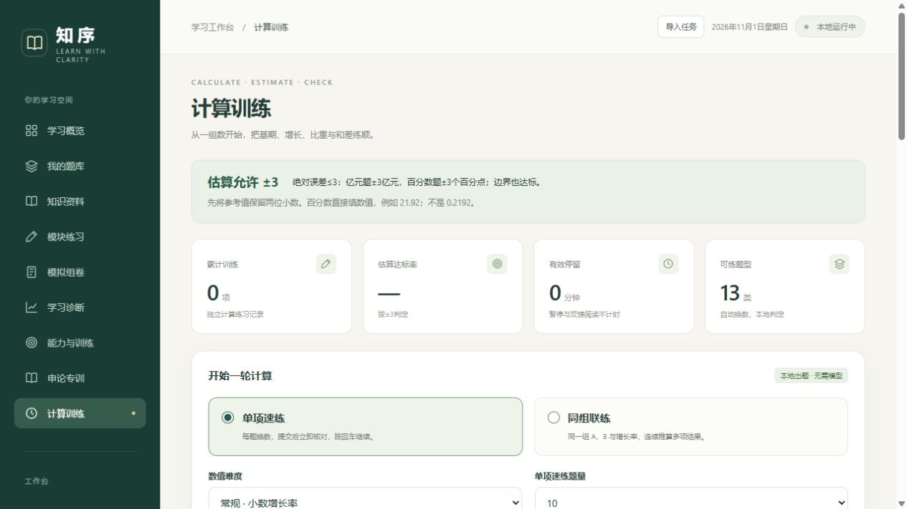

# 知序 · GongkaoTutor

面向公务员与事业单位备考的本地个人学习工作台。导入自己的知识资料和题库，完成练习后对照具体作答找问题，再用短训练和新题验证改善。

**版本0.11.0 · Windows 10/11 · Python 3.11及以上（推荐3.12）**。前端无需Node.js或构建工具。



## 快速开始

1. 安装Python 3.11或以上版本，确保命令行可以使用`py`或`python`。
2. 完整解压项目，双击 **首次安装.cmd**，安装文档解析、本地OCR依赖并下载默认国考真题。首次安装需要联网。
3. 双击 **启动知序.cmd**，访问 <http://127.0.0.1:8765>。
4. 开始国考真题练习或计算训练，也可导入自己的资料与题库。已有题库需在“我的题库”确认替换。
5. 需要个性化语义分析时，在“模型与设置”填写自己的服务地址、模型名和API Key。

双击 **停止知序.cmd** 停止服务。学习数据保存在解压目录的`data/`中。

发布包是源码运行包，不含Python安装程序、预装依赖、OCR权重、个人题库、知识资料、作答记录或模型密钥。基础练习和计算训练可仅用Python标准库启动，扫描页导入需安装依赖。

```powershell
.\install-dependencies.ps1
.\service.ps1 -Action start
.\service.ps1 -Action status
.\service.ps1 -Action stop
```

详细步骤见 [安装说明](docs/INSTALL.md)。

## 默认国考真题

来源为[ERRRC/xingcezhenti](https://github.com/ERRRC/xingcezhenti)，固定提交与文件校验清单见[banks/guokao](banks/guokao/README.md)。2016—2026年行测，27个卷型索引、3564条试卷题目记录，按题面内容合并为2711个指纹，包含3780张来源配图。跨卷有重复，卷型索引不代表已核验官方完整卷。

首次下载约31 MB，题面、选项、共用材料和解析分别保存，图推和表格直接使用原始配图。来源包含整理/网友回忆版，答案未逐题官方核验。上游未提供独立题库转载许可，仓库仅分发适配代码和路径校验清单，不将题库内容改挂为MIT。下载后保存于本机。

旧题库归档保留，作答、历史成绩、知识资料及模型配置不覆盖，可恢复。当前默认来源只含行测，不含完整申论材料；原申论题留在可恢复旧题库。[使用与恢复说明](docs/national-bank-0.11.md)。

## 功能

| 功能 | 使用方式 |
| --- | --- |
| 资料与题库导入 | 同批上传、逐个指定用途；资料进入知识库，题库预览核对后入库 |
| 大文件与本地OCR | 单文件最多500 MB、每批最多100个；扫描PDF/图片逐页识别、续传、重试与局部修订 |
| 图表与图推阅读 | 保留相关单题裁图与共用材料，可放大；裁图不可靠时阻止模型分析 |
| 模块练习与组卷 | 按模块、知识点、难度、错题或未见题筛选，按模块配额生成套卷 |
| 个性化AI分析 | 对照答案、思路和知识片段分析具体偏离步骤，支持追问与反馈 |
| 增量综合分析 | 用户确认范围后调用API，保存旧结论，只整合新增或修订证据 |
| 能力与短训练 | 从实际作答形成待验证假设，按步骤训练，再用未见题验证迁移 |
| 申论专训 | 材料采点、表达改写、组织方式对照；七维画像整合跨题证据 |
| 计算训练 | 单项速练、同组联练，13类计算自动换数，暂停续练、公式讲解和分类记录 |
| 表现参考 | 满足独立模考样本条件后给近期描述性区间，不作为实际考试预测 |

申论七维包括：层次划分、主旨凝练、业务熟悉度、材料要点提取、关系与论证、表达规范、作答效率。业务熟悉度需要思路或问答证据，耗时环节需要分步记录；没有证据时不预填个人薄弱点。

## 计算训练的±3规则

采用**绝对误差≤3，包含边界**，先将参考值保留两位小数。

- 数量：参考142.43亿元，139.43～145.43亿元均达标。
- 百分数：参考比重21.92%，18.92%～24.92%均达标，即±3个百分点。
- 直接填`21.92`或`21.92%`；不能用`0.2192`代替21.92%。
- 空白记为未作答。接近零的有符号结果若方向不同但在容差内，仍按范围判定，并提示核对方向。

练习覆盖基期、增长量、比重、比重差、比值增长率、基期和差、间隔与和差增长率。完全本地运行，不产生模型费用，也不混入模考成绩。

## 数据与模型

题库、知识、作答和配置保存在本机。Windows下保存的密钥使用当前账号DPAPI加密，不进入前端响应、普通日志或JSON导出。新安装没有预配置密钥，需自行填写。

调用模型时，相关题目、作答、知识片段和必要裁图会发送给配置的服务商，可能产生服务商费用。综合分析预览只读取本地记录，确认后才发送；无新证据时直接复用结论。

服务仅监听`127.0.0.1`，面向本机单人使用，没有多用户账号或互联网部署功能。完整备份应停止服务后复制整个`data/`；跨Windows账号迁移需重新填写密钥。见 [数据与隐私](docs/DATA_AND_PRIVACY.md)。

## 当前边界

- OCR对复杂表格、公式、跨栏和图形仍可能识别不全，应对照原页核对；Word内嵌扫描图片暂不单独OCR。
- 知识检索使用本地文本相关性检索，未实现向量库或知识图谱。
- 分类建议、能力假设和模型批改可有误，保留证据不足、待验证和反馈入口。
- 申论未知满分、材料不全或大作文只给定性建议，模拟估分不覆盖原成绩。
- 分析与导入有长度和批次上限，超限明确提示或保留下一批。
- 模考参考区间至少需要3次满足独立、未见题、无提示、全部计分条件的限时模考，未经过真实考试校准。

见 [使用手册](docs/USER_GUIDE.md) 与 [版本记录](CHANGELOG.md)。

## 开发与验证

后端为Python标准库HTTP服务与SQLite，前端为原生HTML/CSS/JavaScript。安装开发依赖后运行：

```powershell
.\.venv\Scripts\python.exe -m pip install -r requirements-dev.txt
.\.venv\Scripts\python.exe -m unittest discover -s tests -q
# 已安装Node.js时，可选做语法检查
node --check web/app.js
node --check web/calculation-training.js
```

Windows凭据测试需要普通用户的DPAPI权限；OCR测试使用Windows中文字体。开发可用`python app.py --port 8766 --data-dir work/qa-data`启动独立库。见 [架构说明](docs/ARCHITECTURE.md)。

`requirements-tested.txt`记录本次环境的直接依赖版本，不锁定所有传递依赖。运行`python scripts/build_release.py`可按文件白名单生成源码包与SHA-256清单。

## 许可与来源

项目代码按 [MIT许可](LICENSE) 发布。申论方法参考 [coffe-d/Shenlun.skill](https://github.com/coffe-d/Shenlun.skill) 的固定提交；选定规则保留原MIT许可、署名和校验清单，不执行上游脚本。

第三方许可不覆盖原始讲义、真题或其他材料的权利。发布包不附带这些内容，使用者应自行准备有权使用的资料。其他依赖见 [第三方声明](THIRD_PARTY_NOTICES.md)。
